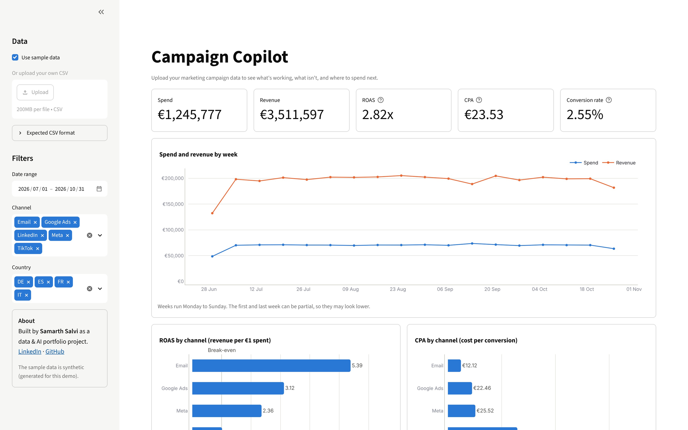
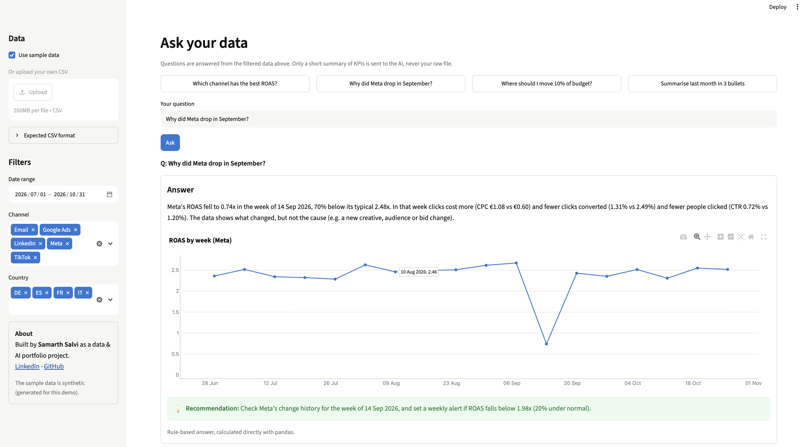

# 📊 Campaign Copilot

**Upload your marketing campaign data and get KPIs, charts and plain-English answers from an AI analyst in seconds.**

### 👉 [Try the live demo](https://campaign-copilot-samarth.streamlit.app/)
*No install needed. It opens with sample data. If the app has been asleep, click "Yes, get this app back up" and wait about 30 seconds.*

Built by **Samarth Salvi** · [LinkedIn](https://www.linkedin.com/in/samarth-salvi-1010) · [GitHub](https://github.com/samsalvi1010)

---

## The business problem

Marketing teams run campaigns across many channels (Google Ads, Meta, TikTok, LinkedIn, Email) and countries. The data exists, but turning it into decisions is slow:

- Every platform reports differently, so comparing **return on ad spend (ROAS)** or **cost per acquisition (CPA)** across channels means manual spreadsheet work.
- Problems hide in the totals. One channel can collapse for a week while the overall numbers look fine.
- Marketers often have questions like *"where should I move budget?"* but no analyst available to answer them quickly.

Campaign Copilot gives a marketer a clean dashboard plus an AI assistant that answers those questions **with real numbers, a chart and one concrete recommendation**.

## Features

- **Upload any campaign CSV**, or use the built-in sample data. Files are validated and cleaned, with clear error messages.
- **Filters** for date range, channel and country. Everything on the page updates together.
- **KPI cards:** spend, revenue, ROAS, CPA and conversion rate.
- **Charts:** weekly spend vs revenue, ROAS by channel (with a break-even line), CPA by channel, and a campaign table ranked by ROAS.
- **Ask your data:** type a question or click an example. The AI replies with:
  - a short answer quoting real numbers
  - a chart it picks from an allowed list
  - one recommended action
- **Weekly report:** one click produces an executive summary (3 wins, 3 issues, 3 actions) that you can download as Markdown.
- **Always works, even without AI:** if there's no API key or the AI service fails, a rule-based backup built with pandas still answers.
- **Privacy by design:** the raw file is **never** sent to the AI, only a compact KPI summary (about 9 KB instead of 270 KB).

## Screenshots

**Dashboard**



**Ask your data**



## How it works

```
   CSV file (upload or sample)
        │
        ▼
   pandas: load & clean          src/kpis.py   check columns, parse dates, drop duplicates,
        │                                      fill missing values
        ▼
   pandas: KPIs                  src/kpis.py   CTR, CPC, conversion rate, CPA, ROAS
        │                                      by channel / campaign / country / week / month
        ├──────────────────────► Dashboard     src/charts.py (plotly) + app.py (Streamlit)
        ▼
   Compact text summary          src/ai.py     small KPI tables only, never the raw rows
        │
        ▼
   LLM (Google Gemini)           src/ai.py     question + summary in, JSON out
        │
        ▼
   JSON, validated               src/ai.py     {answer, chart: {group_by, metric, channel},
        │                                       recommendation}; anything invalid is rejected
        ▼
   Chart + answer on screen      src/charts.py the AI only *chooses* the chart;
                                               my own code calculates and draws it
```

Design choices worth noting:

- **The AI never calculates the dashboard numbers.** pandas computes every KPI, and the AI only interprets them. The report's key-numbers table also comes straight from pandas.
- **Structured output.** Gemini must reply in a fixed JSON schema, and the reply is validated again in Python before anything is shown.
- **Graceful fallback.** Timeouts, rate limits and invalid replies all fall back to the rule-based answer, so the app never crashes in front of a user.
- **KPIs come from totals, not averages of ratios.** For example, ROAS = total revenue ÷ total spend, which avoids a common analysis mistake.

## Tech stack

| Area | Tools |
|---|---|
| Language | Python |
| Data | pandas |
| Charts | plotly |
| Web app | Streamlit |
| AI | Google Gemini via the `google-genai` SDK (structured JSON output) |
| Testing | pytest (45 tests; the AI is mocked so tests run offline) |

## Run it locally

```bash
# 1. Get the code
git clone https://github.com/samsalvi1010/campaign-copilot.git
cd campaign-copilot

# 2. Create a virtual environment and install the packages
python3 -m venv .venv
source .venv/bin/activate          # Windows: .venv\Scripts\activate
pip install -r requirements.txt

# 3. (Optional) Add a Gemini API key for the AI features
cp .streamlit/secrets.toml.example .streamlit/secrets.toml
#    then open .streamlit/secrets.toml and paste your key
#    (free key: https://aistudio.google.com/apikey)

# 4. Start the app
streamlit run app.py
```

Without a key, everything still works: questions and reports use the rule-based backup.

Other useful commands:

```bash
pytest                              # run the tests
python scripts/generate_data.py     # re-create the sample dataset
```

## About the data

**The sample data is synthetic.** It's generated by `scripts/generate_data.py` with a fixed random seed, so it's the same on every run. It covers daily data from 1 July to 31 October 2026 for 5 channels and 4 countries (FR, DE, ES, IT). Two realistic stories are built in for the analysis to discover:

1. **TikTok** has the cheapest clicks but very few conversions, so it loses money (ROAS 0.70x).
2. **Meta** performance collapses in the week of 14 September 2026, with costlier clicks and fewer sales, then recovers.

## Project structure

```
app.py                  Streamlit page: sidebar, KPIs, charts, Ask your data, weekly report
src/kpis.py             Load & clean CSVs, calculate KPIs (overall and grouped)
src/charts.py           Plotly chart functions with one shared style
src/ai.py               Data summary, Gemini calls, JSON validation, rule-based backup, report
scripts/generate_data.py  Creates the synthetic sample dataset
tests/                  pytest tests for KPIs and AI logic
```

## Next steps

- **GA4 / BigQuery connector:** pull campaign data straight from Google Analytics 4 or a BigQuery table instead of uploading CSVs.
- **Anomaly alerts:** check each channel's weekly KPIs automatically and send an email or Slack alert when ROAS drops well below normal (like the Meta week).
- **Multi-language:** answers and reports in French, German, Spanish and Italian, matching the markets in the data.
